<div align="center">

# Plugboard

**A fast, local-first database client for PostgreSQL, MySQL, SQLite, ClickHouse, Cassandra and Redis.**<br>
No accounts, no cloud sync, no telemetry — just you and your data.

[](https://github.com/falsea3/plugboard/actions/workflows/ci.yml)
[](https://github.com/falsea3/plugboard/releases/latest)
[](LICENSE)
[](https://github.com/falsea3/plugboard/releases/latest)

[**Download**](https://github.com/falsea3/plugboard/releases/latest) · [Tour](#a-quick-tour) · [Features](#features) · [Shortcuts](#keyboard) · [Build from source](#building-from-source)

</div>

<picture>
  <source media="(prefers-color-scheme: light)" srcset=".github/assets/screenshots/table-light.png">
  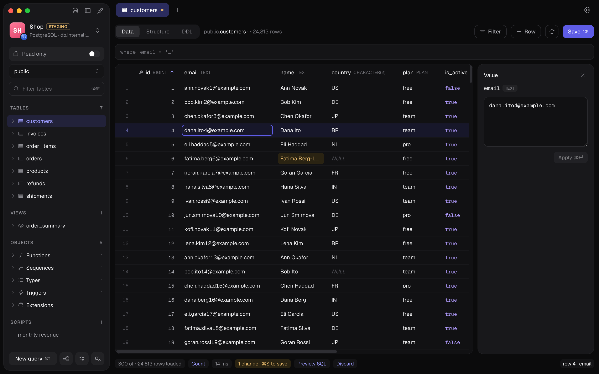
</picture>

<table>
  <tr>
    <td align="center"><b>6 engines</b><br><sub>PostgreSQL · MySQL / MariaDB · SQLite<br>ClickHouse · Cassandra · Redis / Valkey</sub></td>
    <td align="center"><b>Safe on production</b><br><sub>read-only sessions, a confirm before<br>every write, one transaction per save</sub></td>
    <td align="center"><b>Local-first</b><br><sub>passwords in the system keychain,<br>connections in a plain JSON file</sub></td>
    <td align="center"><b>Agent-ready</b><br><sub>a built-in MCP server for<br>Claude Code, Cursor and Codex</sub></td>
  </tr>
</table>

---

## Download

Grab the latest build from the [releases page](https://github.com/falsea3/plugboard/releases/latest).

| Platform                                  | File                                                 |
| ----------------------------------------- | ---------------------------------------------------- |
| macOS 12+ on Apple Silicon (M1 and later) | `-darwin-arm64.dmg` — drag Plugboard to Applications |
| macOS 12+ on Intel                        | `-darwin-amd64.dmg`                                  |
| Windows 10/11 (x64 or Arm64)              | `-installer.exe`                                     |
| Linux (x64)                               | `.AppImage` — `chmod +x`, then run it                |

Plugboard looks for a new version when it starts and offers to install it, or installs it by itself if you turn that on in Settings. Every release ships SHA-256 checksums and signatures, and the app refuses an update that fails either. What changed in each version is in the [changelog](CHANGELOG.md).

<details>
<summary><b>First launch: macOS and Windows warn about unsigned apps</b></summary>

The builds aren't signed by Apple or Microsoft yet. Check the download against `SHA256SUMS.txt` on the release page, then:

- **macOS** — _"can't be opened because Apple cannot check it"_: open it once, then click **Open Anyway** in System Settings ▸ Privacy & Security. If it says the app _is damaged_, run `xattr -dr com.apple.quarantine "/Applications/Plugboard.app"`.
- **Windows** — SmartScreen's _"Windows protected your PC"_: click **More info** ▸ **Run anyway**.

You do this once; updates the app installs itself don't ask again.

</details>

---

## A quick tour

### All your connections, in groups

Group connections by project, drag them into the order you like, and see everything about one at a glance: its address, the SSH route, latency, database size, schemas, and the tabs you left open last time.

<picture>
  <source media="(prefers-color-scheme: light)" srcset=".github/assets/screenshots/home-light.png">
  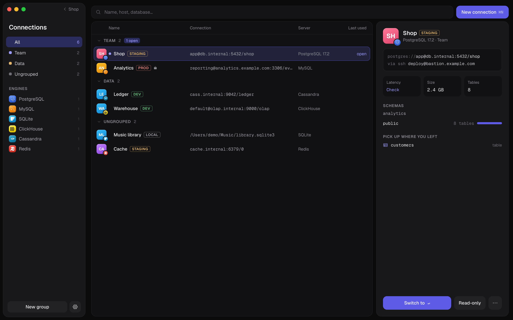
</picture>

### Switch without leaving your work

`⌘K` opens the switcher right under the connection you're in: search, collapse groups, drag connections between them. `⌃Tab` cycles through the open ones. Each open connection keeps its own tabs.

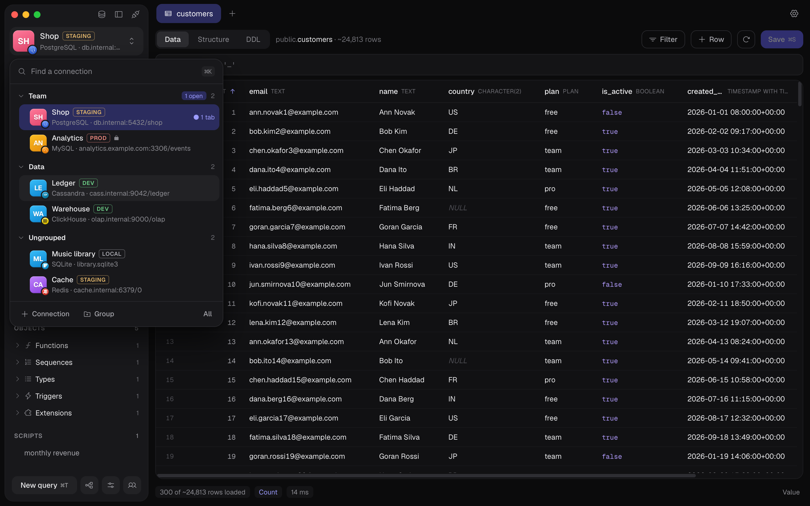

### Tables that feel like a spreadsheet

Type into a cell, `⇧↵` for a big editor, `⌘S` to save. Pending changes are tinted until you commit them, and _Preview SQL_ shows exactly what will run. Long values and JSON open in their own editor with validation and formatting.

<table>
  <tr>
    <td width="50%">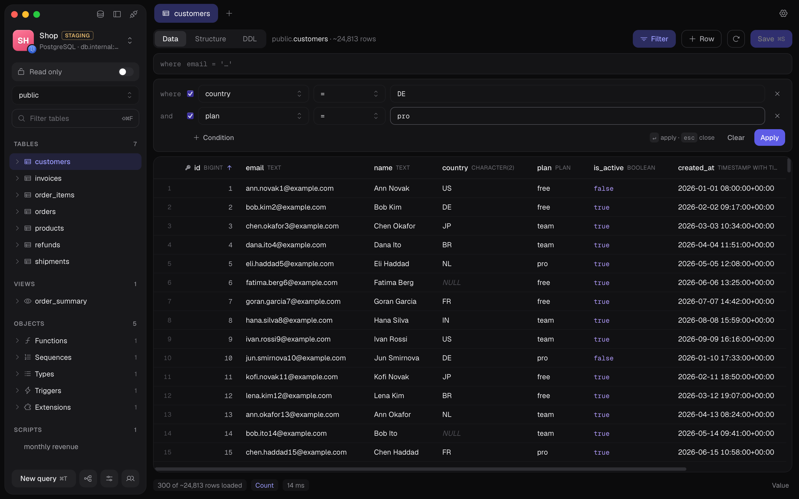</td>
    <td width="50%">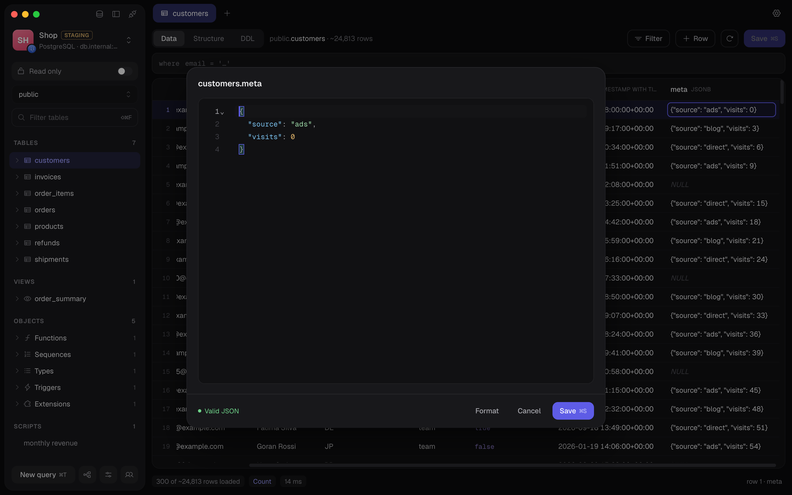</td>
  </tr>
  <tr>
    <td align="center"><sub>Filter with a plain <code>WHERE</code> or by column, <code>⌘F</code></sub></td>
    <td align="center"><sub>JSON editor that never loses big integers</sub></td>
  </tr>
</table>

### A SQL editor that knows what you mean

`⌘↵` runs the statement under the cursor — it's highlighted, so you always know which one — and `⇧⌘↵` runs the whole script. Mistakes are underlined while you type, checked by the server itself. Format, save as a script, copy or export the result as CSV.

<picture>
  <source media="(prefers-color-scheme: light)" srcset=".github/assets/screenshots/query-light.png">
  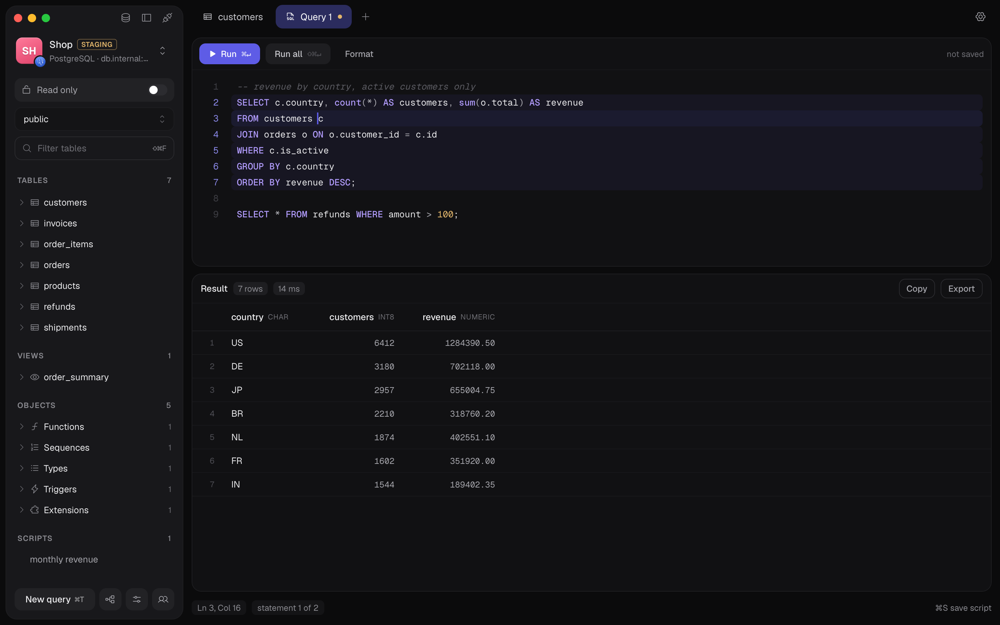
</picture>

### Structure and schema

Change columns in a grid and commit them like rows — PostgreSQL and SQLite do it in one transaction. The diagram lays out every table and foreign key for you, and exports to PNG or SVG.

<table>
  <tr>
    <td width="50%">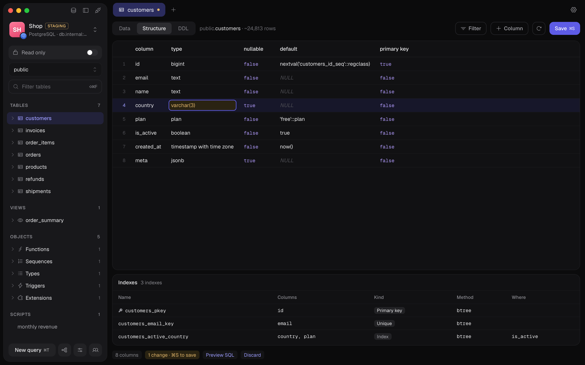</td>
    <td width="50%"><picture><source media="(prefers-color-scheme: light)" srcset=".github/assets/screenshots/diagram-light.png">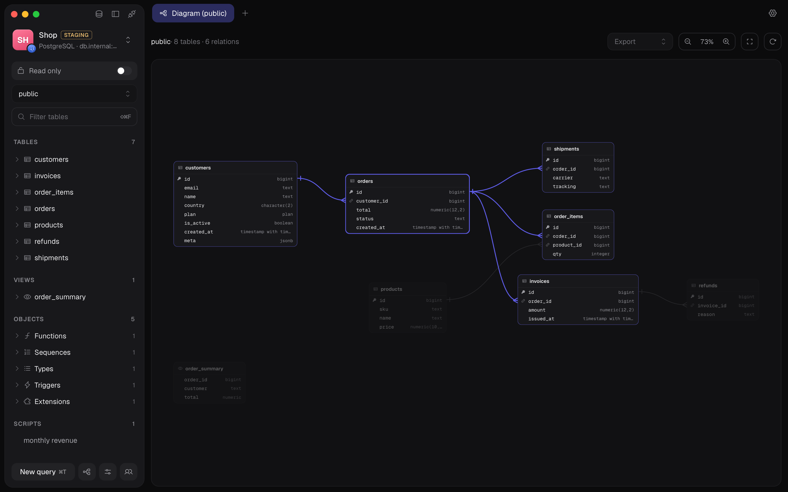</picture></td>
  </tr>
</table>

### Redis, as a tree

Keys grouped by `:`, every type in a view that fits it, TTLs, renames, and a console that keeps `SELECT` and `MULTI … EXEC` on one connection.

<table>
  <tr>
    <td width="50%">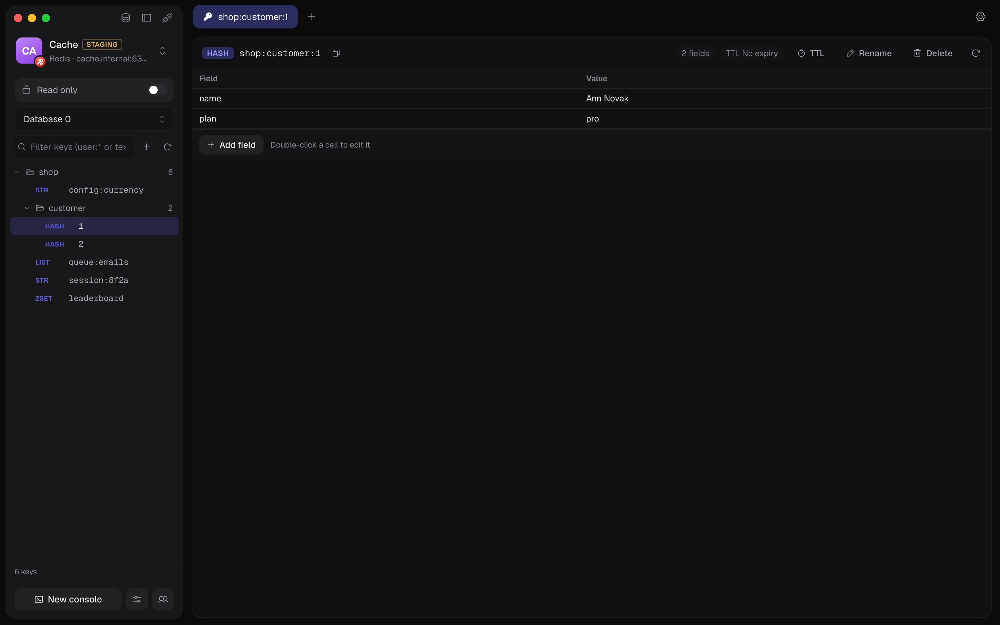</td>
    <td width="50%">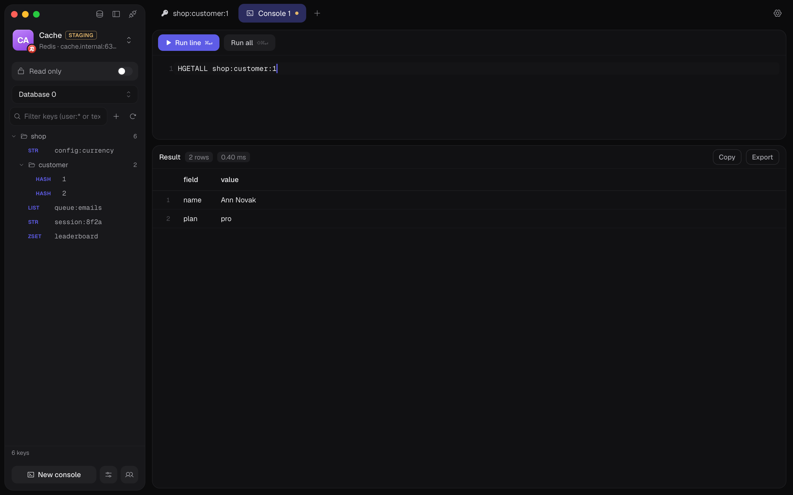</td>
  </tr>
</table>

### Run the server, not just the data

Edit `postgresql.conf` or `pg_hba.conf` — over SSH when the database lives on that host, through SQL otherwise — with the server's own check before it reloads. Manage users and roles in PostgreSQL, MySQL, ClickHouse, Cassandra and Redis ACLs, and see the exact SQL before it runs.

<table>
  <tr>
    <td width="50%">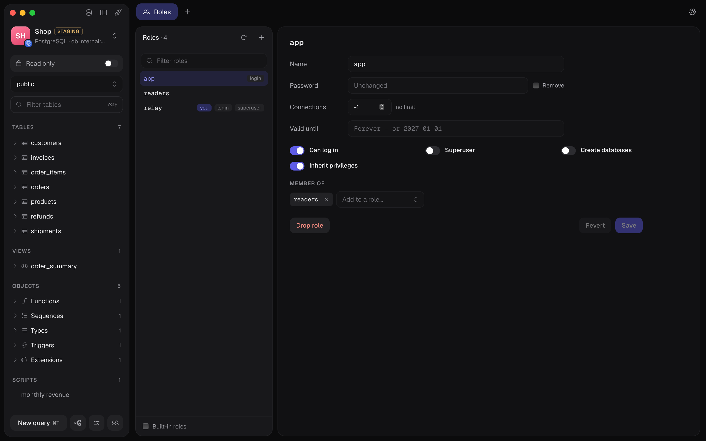</td>
    <td width="50%">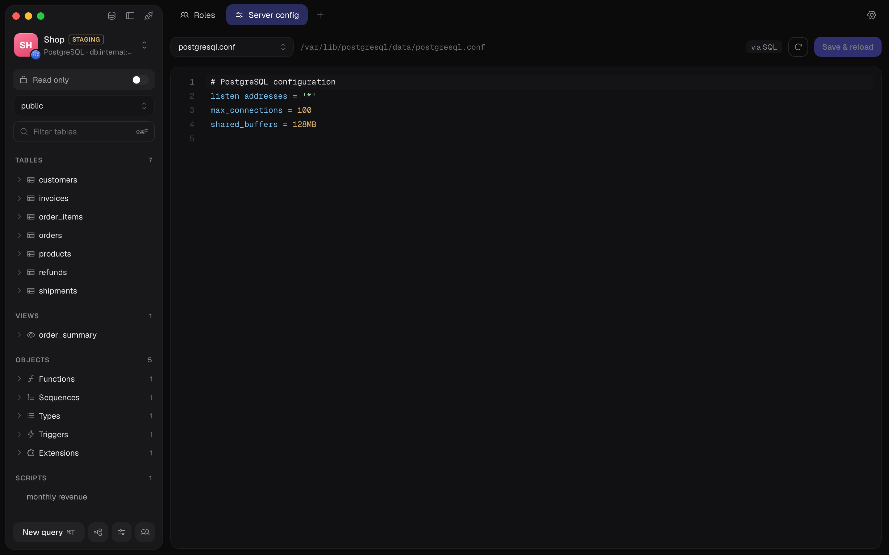</td>
  </tr>
</table>

### Connect once, safely

Paste a URL and the form fills itself in. SSH through a bastion or straight into the database host, with a password, a key or ssh-agent; a dropped tunnel comes back on its own. Tag a connection Production and it opens read-only, with a confirmation before anything writes.

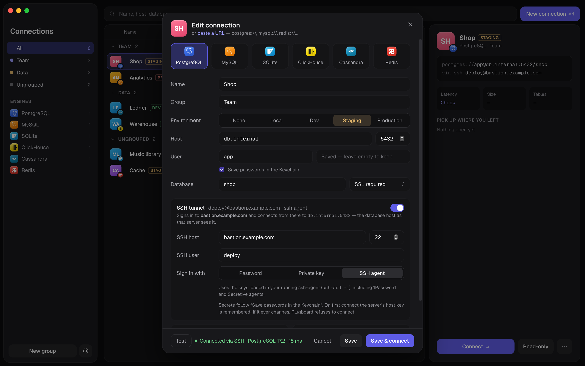

### Let AI agents look, not touch

Plugboard is also an MCP server. Add it to Claude Code, Codex or Cursor with one command, and agents can list tables, read structure and run queries through your saved connections — without ever seeing a password.

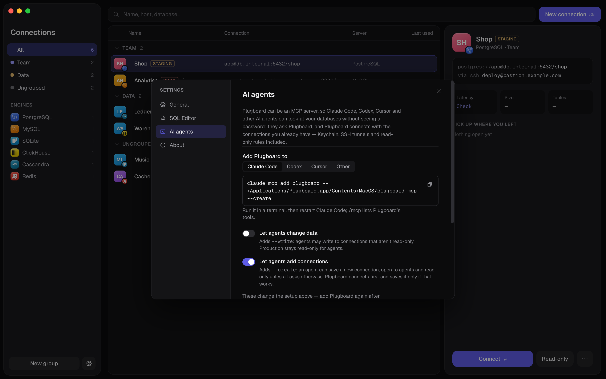

---

## Features

**Connections**

- PostgreSQL, MySQL and MariaDB, SQLite files, ClickHouse, Cassandra, and Redis or Valkey — several open at once, each with its own tabs.
- Groups you can collapse and reorder, a switcher on `⌘K`, `⌃Tab` between open connections, and when you last used each one.
- Tag a connection _local_, _dev_, _staging_ or _prod_, so you always know where you are.
- Paste a connection URL — `postgres://…`, `mysql://…`, `clickhouse://…`, `cassandra://…`, `redis://…`, a JDBC URL or a line from a `.env` file — and the form fills itself in.
- **SSH tunnels** through a bastion, or straight into the database server, with a password, a private key or ssh-agent. A dropped tunnel comes back on its own.
- Passwords stay in the system keychain (Keychain, Windows Credential Manager, Secret Service) — never in a file on disk.

**Hard to break production by accident**

- **Read-only connections**, on by default for anything tagged Production. Plugboard refuses writing statements before they run, and the database session itself is read-only too, so a statement that slips past one still meets the other.
- Writes to a Production connection ask first, and show exactly what they will run.
- Edits in the grid are applied in one transaction — every change lands, or none does — and a value too long for its column is an error, never quietly cut short.
- If a connection drops while a statement is running, Plugboard never re-runs a write behind your back, and tells you when an open transaction was lost.
- A changed SSH host key is refused until you've seen the new fingerprint and trusted it.

**Tables**

- Big tables page by primary key, so scrolling through millions of rows stays as fast as the first screen. The row count shows the server's estimate at once and the exact number on request.
- Filter with a plain `WHERE` condition or by column (`⌘F`): equals, contains, starts with, in a list, is NULL and more — or right-click a cell and _Filter by this value_.
- Edit like a spreadsheet: type into a cell, `⌥⌫` for NULL, `⌘I` to add a row, `⌘⌫` to delete. Right-click offers what fits the column — true/false, `now()`, DEFAULT, the values of an enum.
- Changes wait until `⌘S`; _Preview SQL_ shows the statements first. The Value panel shows the selected cell in full.
- Huge values (megabytes of JSON or text) arrive cut short and load in full only when you ask.
- Structure, DDL and indexes for every table; functions, sequences, types, triggers and extensions in the sidebar.
- Follow a foreign key: the arrow in a key cell opens the row it points at.
- A schema diagram of tables, columns and foreign keys, laid out for you, exported as PNG or SVG.

**SQL editor**

- Highlighting for each database's dialect, completion of table names, and formatting.
- `⌘↵` runs the highlighted statement under the cursor, `⇧⌘↵` the whole script, Stop cancels.
- Statements share one connection, so `BEGIN … COMMIT`, `SET` and temporary tables behave the way you expect.
- Mistakes are underlined as you type, by Plugboard and by the server's own parser.
- Results arrive a thousand rows at a time; copy them, or export as CSV.
- Save queries as scripts per connection; open tabs come back the next time you connect.

**ClickHouse**

- Databases, tables and views from `system.*`, with each table's sorting key and data-skipping indexes, dictionaries and SQL functions.
- Tables open read-only — ClickHouse has no transactions and its updates are background mutations, so changes go through the SQL editor, where you see exactly what runs.
- The editor checks syntax with `EXPLAIN AST` as you type, which parses without running anything.

**Cassandra**

- Keyspaces, tables, materialized views, user types, functions and secondary indexes, with partition and clustering keys shown as the primary key.
- Tables page through the server's own paging, so a large table scrolls without `OFFSET`.
- Edit rows in the grid: each change is a lightweight transaction (`IF EXISTS` / `IF NOT EXISTS`), so it lands on exactly the row you saw.
- A CQL editor that keeps `BEGIN BATCH … APPLY BATCH` together and follows `USE`. Works through SSH tunnels to a whole cluster.

**Redis**

- Keys as a tree, grouped by `:`, from every database, scanned page by page so a huge keyspace doesn't stall the server.
- Strings, hashes, lists, sets, sorted sets and streams each open in a view that fits them; set a TTL, rename or delete a key.
- Changes that depend on what's there run atomically and refuse if someone else changed the value first.
- A command console on its own connection, so `SELECT`, `MULTI … EXEC` and `WATCH` work.

**Server admin**

- Server configuration files for PostgreSQL, Redis, ClickHouse and Cassandra, with the server's check before a reload.
- Users and roles for PostgreSQL, MySQL and MariaDB, ClickHouse, Cassandra and Redis ACLs — always shown as SQL before they run.

**AI agents (MCP)**

- Add it with one command — Settings ▸ AI agents shows the exact one for Claude Code, Codex and Cursor on your system. On macOS: `claude mcp add plugboard -- /Applications/Plugboard.app/Contents/MacOS/plugboard mcp`; on Windows and Linux it points at the installed `plugboard.exe` or the AppImage.
- Agents never see a password: they ask Plugboard, which connects with your saved connections, Keychain and SSH tunnels.
- Nothing is shared until you turn on _AI agents (MCP)_ for a connection. Sessions are read-only unless you start it with `--write`, and Production is read-only for agents no matter what.
- Every call is logged to `logs/mcp.log` in the profile folder.

## Keyboard

`Ctrl` instead of `⌘` on Windows and Linux.

| Keys             | Does                                                |
| ---------------- | --------------------------------------------------- |
| `⌘K`             | Switch connection                                   |
| `⌃Tab` / `⌃⇧Tab` | Next / previous open connection                     |
| `⇧⌘H`            | All connections                                     |
| `⌘\`             | Hide or show the sidebar                            |
| `⌘T` · `⌘W`      | New query tab · close the tab                       |
| `⌘1` … `⌘9`      | Go to a tab                                         |
| `⌘↵` · `⇧⌘↵`     | Run the statement under the cursor · run everything |
| `⌘S`             | Save changes, or save the script                    |
| `⌘F` · `⇧⌘F`     | Filter rows · filter the table list                 |
| `⌘I` · `⌘⌫`      | Add a row · delete the selected rows                |
| `⇧↵`             | Open the cell in a big editor                       |
| `⌘R`             | Reload                                              |

## Local-first

Your connections live in a plain JSON file in your profile folder and your passwords in the system keychain. Plugboard talks to your databases, your SSH servers and, at launch, to GitHub to look for updates — nothing else.

|         | Profile folder                            |
| ------- | ----------------------------------------- |
| macOS   | `~/Library/Application Support/Plugboard` |
| Windows | `%AppData%\Plugboard`                     |
| Linux   | `~/.config/Plugboard`                     |

---

## Building from source

You need Go 1.26+, Node.js 22.12+ and the [Wails v2](https://wails.io/docs/gettingstarted/installation) CLI.

```bash
git clone https://github.com/falsea3/plugboard
cd plugboard
npm install
make dev
```

`make build` builds the app for your platform, `make check` runs the tests, and `make screenshots` retakes the pictures in this README. [CONTRIBUTING.md](CONTRIBUTING.md) has the rest: sample databases to develop against, what CI checks, and how the code is laid out.

## Contributing

Bug reports, ideas and pull requests are welcome — start with [CONTRIBUTING.md](CONTRIBUTING.md). Everyone taking part is expected to follow the [Code of Conduct](CODE_OF_CONDUCT.md).

Found a security problem — a way past read-only, a leaked password, an SSH key accepted when it shouldn't be? Please **don't** open a public issue; see [SECURITY.md](SECURITY.md).

## License

[MIT](LICENSE). Bundled icons, logos and fonts keep their own licences — see [THIRD_PARTY_NOTICES.md](THIRD_PARTY_NOTICES.md).
